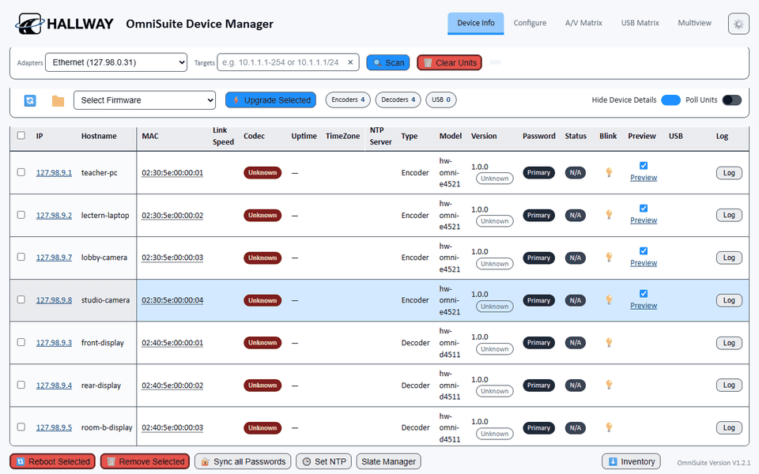
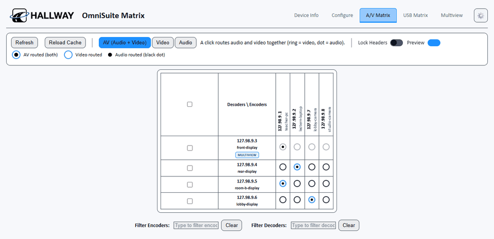
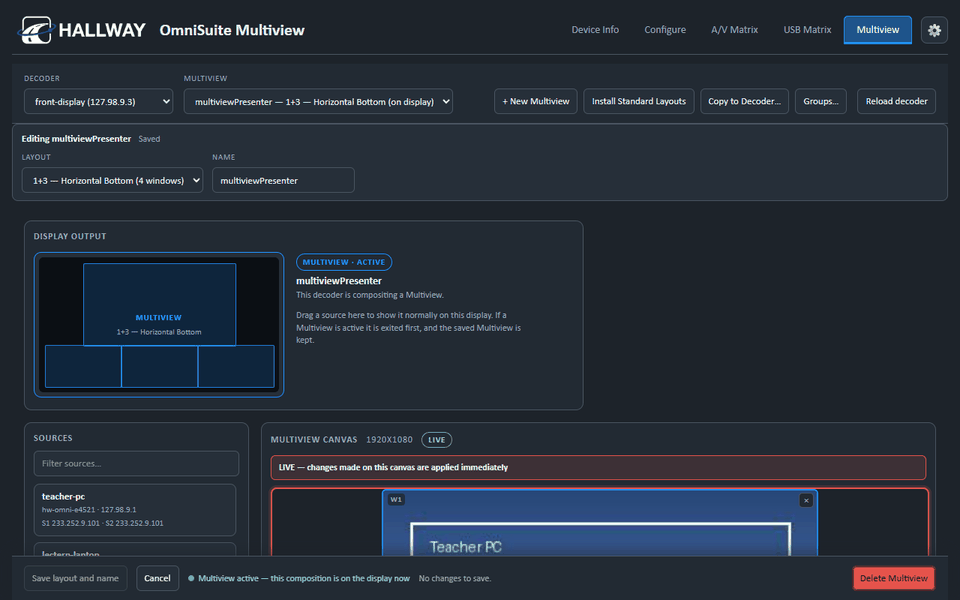
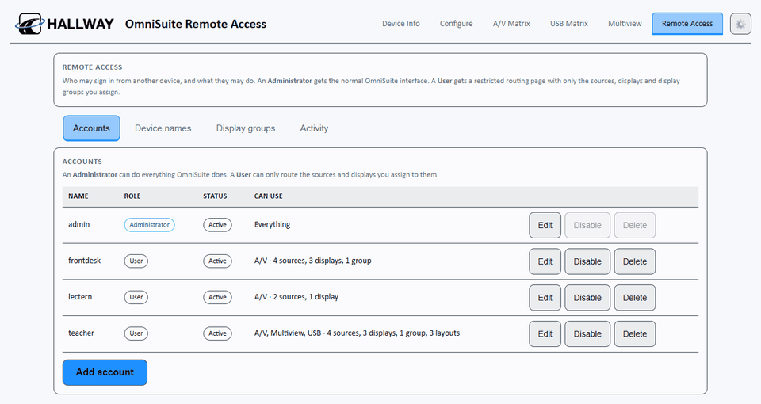
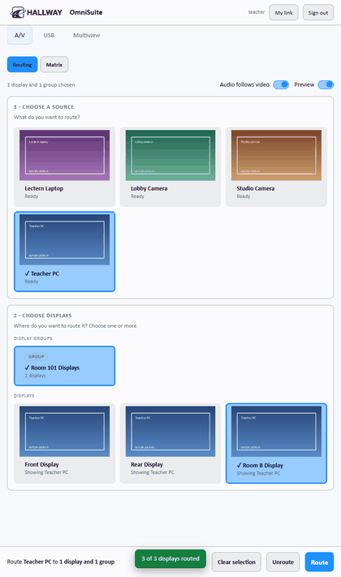
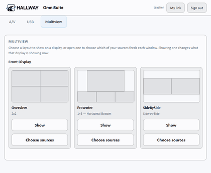

# OmniSuite

A management application for Atlona and Hall Research **OmniStream** AV-over-IP
encoders and decoders, and for the **HW-OMNI-311 / HW-OMNI-324** USB extenders
and the Icron USB endpoints built into E4521 and D4511 units.

OmniSuite runs on the management PC, talks to each device directly, and presents
one inventory: discovery, configuration, A/V routing, USB routing, firmware,
diagnostics and reporting.

**Version: V1.2.1**

---

## Highlights

- **One discovery console.** Pick the adapter, scan, and every page works from
  the same inventory. Devices are identified by MAC, so a unit that changes
  address updates its existing row instead of appearing twice.
- **Encoder and decoder configuration** — inputs, EDID, HDCP, sessions,
  encoding, resolution, fast switching, video wall, hostnames, NTP, per-unit
  config export and import.
- **A/V Matrix** — encoders across the top, decoders down the side, with
  separate AV, Video and Audio routing modes.
- **Multiview** — build a multi-window picture on a decoder from several
  encoders. Eleven standard layouts, saved presets that may be left empty or
  partly filled, live source switching on the picture that is on screen, and
  synchronized decoder groups. Every change is read back from the device and
  undone if it cannot be confirmed.
- **Display output** — a small view of what a decoder is actually showing, and
  a drop target for putting an ordinary source back on the screen.
- **USB Matrix** — LEX and REX endpoints with one-click routing. Clicking a cell
  states the relationship you want and OmniSuite reconciles the hardware to it;
  there is no unpair-then-pair step to perform.
- **Standalone HW-OMNI-311 / HW-OMNI-324 discovery** over their own UDP
  protocol, alongside **integrated Icron endpoints** discovered through their
  parent OmniStream unit — one row per physical endpoint either way.
- **Multi-peer USB.** One host can hold several remote peers; adding or removing
  one leaves the others alone.
- **Same-subnet safety.** A USB pairing across different subnets does not work,
  so OmniSuite refuses to create one and says why. The check fails closed and
  never tears down a working route.
- **LLDP topology awareness** — which switch each device is attached to, with
  advisories when the fleet spans more than one switch or when a unit is daisy
  chained behind another.
- **Inventory export** to a two-sheet XLSX workbook, and a **TS Dump** JSON file
  for support with passwords masked.
- **Encrypted device logs** collected on request for manufacturer Engineering.
- **Remote Access** (off until an administrator turns it on) — reach OmniSuite from a phone, tablet
  or laptop, with administrator and user accounts. A User routes only the equipment assigned to them,
  through **Standard routing**, a **User Matrix** (AV, Video and Audio), **USB** and **Multiview** (an
  administrator saves the layouts; the person chooses which of their own sources feeds each window), and can
  route to a **Display Group** of displays in one action. Optional passwordless **direct access links** per account.
- **Backup and restore** — one passphrase-encrypted file holds the configuration that makes an
  installation yours, and a restore is all-or-nothing.
- **Firmware availability** — reports whether Hall Research has published newer firmware for each model.
  It never downloads or installs anything.
- **Appearance** — light and dark, ten colour presets, two layouts (Classic and Compact).
- **Update notification** — OmniSuite may contact GitHub at startup to check whether a
  newer OmniSuite version is available, and tells you when one exists. It never downloads or
  installs anything for you. A separate, optional firmware check reads Hall Research's public
  product pages (see the User Guide, "What OmniSuite contacts on the Internet").

---

## Screenshots

All screenshots below were taken from this version, against simulated units on a test network, so the
addresses, names and accounts in them are invented. The bundled [User Guide](ui/user-guide.html) shows
every page with numbered callouts.

**Device Manager** - discovery and inventory.



**A/V Matrix** - encoders across the top, decoders down the side. A decoder that is showing a Multiview is marked.



**Multiview** (dark appearance) - several encoders composited on one decoder, with the live canvas.



**Remote Access accounts** - administrators and Users, each limited to the equipment assigned to them.



**Remote User screens** - routing and Multiview on a phone or tablet.

 

---

## Downloads

Get the archive for your machine from the
[Releases page](https://github.com/Hall-Research-Technologies/OmniSuite/releases).

| Platform | Artifact |
|---|---|
| Windows x86-64 | `OmniSuite-V1.2.1-Windows-x86_64.zip` |
| macOS Apple Silicon | `OmniSuite-V1.2.1-macOS-arm64.zip` |

OmniSuite is built for **Windows x86-64 and macOS on Apple Silicon only**. There is no
macOS Intel build, no Linux build and no universal macOS build. On an unsupported computer
the in-app update check says there is no supported update package rather than offering a
download that would not run.

Each release also carries `SHA256SUMS.txt`. To check a download:

```bash
shasum -a 256 -c SHA256SUMS.txt      # macOS
```
```powershell
Get-FileHash .\OmniSuite-V1.2.1-Windows-x86_64.zip -Algorithm SHA256
```

See **[Supported platforms](#supported-platforms)** below for what has actually
been tested on each one — the levels are not the same.

---

## Getting started

1. **Download** the archive for your platform and extract it.
2. **Launch OmniSuite.**
   - Windows: run `OmniSuite.exe`.
   - macOS: open `OmniSuite.app`. It is **not signed or notarised**, so macOS
     blocks the first launch; approve it under **System Settings → Privacy &
     Security → Open Anyway**. Step by step, and what to check before you
     approve it: [docs/INSTALL_MACOS.md](docs/INSTALL_MACOS.md). The same text is
     in the zip as `READ-ME-FIRST-macOS.txt`.
3. A small launcher window appears and **your browser opens** on the OmniSuite
   interface. OmniSuite serves on `127.0.0.1:8080`, or the next free port if
   8080 is taken — the launcher shows and logs the address it chose. If you
   want the same address every time, ask for a fixed port (see
   [Local application port](#local-application-port)).
4. **Allow OmniSuite through the firewall** if your system prompts you. It talks
   to devices directly, so a blocked process and an empty network look identical
   in the UI.
5. Open **Settings** (the gear) and set the device **username and password**
   your units use.
6. Choose your **network adapter** on Device Info and press **Scan**.

Everything else is in the **User Guide**, reachable from Settings, from the
navigation, or at `/help` while OmniSuite is running.

---

## Network requirements

- OmniSuite must be able to **reach the devices directly** from the machine it
  runs on. Nothing discovers on its behalf.
- **Host firewall and endpoint security may need to permit it.** Allow the
  OmniSuite process and its traffic. **Do not disable your firewall** — the
  permission it needs is for itself, not an unprotected machine. On a managed PC
  this is usually an IT request.
- **Broadcast discovery does not cross a router.** It finds unknown devices on
  the directly attached network only; that is how IP broadcast works.
- Devices on **other subnets** are found by entering their network in **Targets**
  on Device Info, which also becomes the configured USB discovery network. Once
  known, they are kept visible by directed polling, which does route.

---

## USB

OmniSuite routes USB between two kinds of endpoint:

- **LEX** — the *host* end (local extender). This is where the computer plugs
  in. An E4521 is a LEX; so is a standalone HW-OMNI-311.
- **REX** — the *device* end (remote extender). This is where the keyboard,
  mouse, camera or hub plugs in. A D4511 is a REX; so is a standalone
  HW-OMNI-324.

A USB route is created by clicking the cell where a LEX column meets a REX row.
Moving a REX to a different host is one click — OmniSuite works out what to
release and what to create.

**Both endpoints of a USB route must be on the same USB subnet.** Management
traffic routes happily across subnets; USB pairing does not. OmniSuite computes
this from each endpoint's own address and mask and refuses a route it cannot
prove is valid, rather than breaking a working one to find out.

A *configured* pairing and a *live link* are shown separately throughout. A
configured route is not evidence that USB traffic is flowing.

---

## Local application port

By default OmniSuite chooses its own local port at start (8080, or the next free one), so the address
can differ between runs. In **Settings › Local Application Port**, on the OmniSuite computer, you can
tick **Use a fixed TCP port** (1024-65535) and **Save and Restart**; from then on OmniSuite binds
exactly that port.

A fixed port is never silently replaced. If something else holds it when OmniSuite starts, the
launcher says **Server could not start** and offers **Retry**, **Start on Alternate Port** (for this
session only; the fixed port is left as it was), **Change Fixed Port** (saved only once the new port has
actually been bound) and **Exit**. A damaged setting never stops OmniSuite starting: the file is set
aside and OmniSuite returns to automatic. The setting belongs to the computer, so a backup does not
carry it, and it has nothing to do with Remote Access, which has its own port.

---

## Remote Access

Normally OmniSuite answers only on the computer it runs on. **Remote Access** adds a second listener,
bound to the network adapter an administrator picks, so other devices can sign in. It is **off on a new
installation and stays off when you upgrade**. The first administrator is created at the OmniSuite
computer; there is no default password.

- **Transport.** A first-time setup starts on **HTTP**, labelled as not encrypted, and OmniSuite asks you
  to confirm it. **HTTPS** is the recommended choice once a certificate exists. Your choice is kept; OmniSuite
  never switches transport on its own, never falls back from HTTPS to HTTP if the certificate cannot be
  used (Remote Access simply does not start and says why), and does not listen on plain HTTP while HTTPS is
  on. Use HTTP only on a network you trust.
- **Certificates.** Choose **Create one for this network** (OmniSuite makes one) or **Use my own files**. A
  generated certificate uses the computer's Windows name as its name, is issued by *Hall Research* for
  *OmniSuite*, is valid for the computer name and the chosen adapter's address, and lasts **three
  calendar years**. Browsers warn about it once, because nobody outside your building vouches for it;
  the connection is encrypted either way. Settings says whether a certificate is *active*, a *custom
  certificate is active*, or a *certificate is required*, and never says *trusted*. A certificate made by
  an earlier build keeps the name and validity it had; it is not replaced automatically.
- **Accounts.** Administrators can do everything. A User can only route, and only the sources,
  displays and Display Groups assigned to them. Permissions are enforced on the server for every
  request, at the moment it runs.
- **Routing for Users.** Each account gets **Standard routing** (choose a source and a display, press
  Route), the **User Matrix** (sources across the top, displays and groups down the side, with AV, Video
  and Audio modes), or both.
- **Display Groups.** A named set of displays that receive the same source; each display is routed and
  checked in turn, a failure does not stop the others, and nothing is rolled back. A group is not a
  Multiview and is its own permission.
- **Direct access links.** An optional passwordless address for one non-administrator account, off by
  default. Treat the address like a password.
- **Activity.** Administrators can review sign-ins, refusals, routing and account changes.

Remote Access is for your own network. Do not expose OmniSuite to the internet or a guest network.
Details are in the User Guide and in
[docs/REMOTE_ACCESS_ARCHITECTURE.md](docs/REMOTE_ACCESS_ARCHITECTURE.md).

---

## Backup and restore

**Settings › Backup and Restore**, at the OmniSuite computer only, writes accounts and permissions,
device names, Display Groups, Multiview layouts, device sign-in details and scan settings to one file
encrypted with a passphrase you choose (at least 8 characters; it cannot be recovered). A restore shows
what is in the file before it changes anything, and then either completes or puts everything back.

- A restore is **authoritative for what the backup covers**: an account, group or name on this
  computer that the backup does not carry is removed. A section the backup never looked at is left alone.
- The HTTPS certificate and key, the Activity log, scan results and the local port are never restored,
  and on a different computer you choose the network adapter and firmware folder again.
- Anyone signed in as an account the restore removes or changes is **signed out**; an account that comes
  back unchanged stays signed in. The summary names them before you press Restore.

---

## Firmware availability

Once after it starts, and then every seven days, OmniSuite reads what Hall Research has published and
shows **Up to Date**, **Available** or **Unknown** (with the reason) per model, in Settings and beside the
version on Device Info. It runs in the background, works without an internet connection (keeping the last
good answer), and only reports.

---

## Device logs

Each OmniStream encoder and decoder can build a diagnostic bundle for the
manufacturer's support team. The **Log** button on a Device Info row collects it.

- Clicking **Log** first shows a notice: *Device logs are encrypted and can only
  be decrypted and read by Engineering.* **Cancel** is the default; nothing is
  requested from the device until you choose **OK**.
- The device then builds a fresh bundle, which takes a few seconds, and it
  downloads as `hostname_IP_timestamp.vdf`.
- The file is **encrypted by the manufacturer**. OmniSuite passes the bytes
  through untouched and cannot read them. **Send it to Engineering when asked**;
  do not expect to open it yourself.
- Nothing else requests a log — not discovery, polling, startup, the TS Dump or
  the inventory export. Only that button.

---

## Documentation

The full **User Guide** ships with the application and covers first-run setup,
discovery, every page, the configuration dialogs, field rules and
troubleshooting. Open it from Settings › User Guide, from the navigation, or at
`/help` while OmniSuite is running. It is also readable directly:
[`ui/user-guide.html`](ui/user-guide.html).

---

## Supported platforms

Two platforms are distributed, and they are exactly those the release workflow tests and builds, each
on its own native runner: **Windows x86-64** (`windows-latest`) and **macOS Apple Silicon**
(`macos-15`, an arm64 runner), with Python 3.12 and Node 20. The runtime is the pinned Python 3.12
stack in `requirements-lock.txt`.

*Test runner* and *distributed platform* are different things. The full suite runs on both
distributed platforms, and a package is built only on the runner it is named for. The workflow checks the
runner's architecture, and for macOS it reads the Mach-O headers of the built bundle and refuses a
universal or x86-64 binary. macOS Intel and Linux were built before V1.2.1 and are not built now; they are
not tested, not packaged and not offered by the update check.

These levels are deliberately distinct. A release artifact that builds and starts
is not the same as one exercised against real hardware.

| Platform | Release artifact | Automated tests | Physical OmniStream hardware |
|---|---|---|---|
| **Windows x86-64** | Built and smoke-tested | Full suite | **Yes** — developed and validated against a physical bench |
| **macOS Apple Silicon (arm64)** | Built and smoke-tested in CI | Full suite | **No** |

**What "automated tests" covers**: protocol serialisation and parsing, route
logic, UDP and WebSocket handling, HTTP behaviour, persistence and UI behaviour.
The suite is deliberately and verifiably isolated from hardware and from the
network — it makes zero real device connections. That is a strong guarantee
about the code, and it is **not** a substitute for running against devices.

**Physical hardware validation has been performed on Windows only**, against a
bench of OmniStream encoders and decoders, standalone HW-OMNI-311/324 extenders
and integrated Icron endpoints. The macOS artifact is built, started and exercised
through its UI in CI; it has not been used to manage real devices. Treat it as
ready to try, not as field-proven.

### Platform notes

- **Windows** — a portable `OmniSuite.exe` in a zip; there is no installer.
  It is **not Authenticode signed**, so SmartScreen will likely show
  "Windows protected your PC" on first run; choose *More info → Run anyway*.
  Windows Firewall will normally prompt on first launch. Packaged Python
  applications occasionally draw antivirus false positives.
- **macOS** — an `OmniSuite.app` in a zip. Unpack it with Finder (double-click
  the zip) or `ditto -x -k`, both of which keep the symlinks inside the bundle;
  a tool that flattens them leaves the app unable to load its own Python
  framework. It carries only an **ad hoc signature** (the build signs it so that
  Apple Silicon will run it at all), and it is **not Developer ID signed and not
  notarised**, so Gatekeeper will refuse a normal double-click on first launch.
  Approve it under **System Settings → Privacy & Security → Open Anyway**, only
  for a download from the official releases page; see
  [docs/INSTALL_MACOS.md](docs/INSTALL_MACOS.md). macOS also asks for **Local
  Network** access the first time you scan; choose Allow. Developer ID signing and
  notarization are a planned improvement.
- **Not distributed** — macOS Intel and Linux. earlier candidates were built for
  them; V1.2.1 is not. An installed copy on one of those computers can still check for
  updates and is told that no supported update package exists for it.

---

## Version

**V1.2.1.** `VERSION` in this repository is the single source of truth; Settings
reports what the running build was made from, the User Guide states the version
it describes, and the release artifacts take their names from it.

---

## Known limitations

| Area | Behaviour |
|---|---|
| Multiview | A decoder occasionally leaves one window black after a layout change even though the configuration is correct and the stream is arriving. OmniSuite detects this and reports which window rather than claiming success. Showing another Multiview and returning clears it. This is decoder firmware behaviour and is not fixed by this release. |
| Multiview | A decoder with Video Wall enabled cannot run Multiview, and Fast Switching prevents it on the affected 1xx family. OmniSuite reports the reason and does not turn either feature off for you. |
| Certificates | A certificate OmniSuite creates is self-signed, so each browser warns the first time; supply your organisation's certificate to avoid it. A certificate created by an earlier build is not migrated automatically and keeps its original name and validity. |
| Remote Access | A first-time setup starts on HTTP, which is not encrypted. Choose HTTPS once a certificate exists. Remote Access is for your own network, not the internet. |
| Performance | One long soak saw the median time of local route calls rise with how long OmniSuite had been running. It has not been reproduced as a defect and is under investigation; an opt-in diagnostic records the numbers. |
| Memory | A long-running process has been measured growing by roughly 2.5 MB per hour after a forced collection. The cause has not been identified; restarting OmniSuite returns it to its starting size. |
| Platforms | Only Windows has been used against physical hardware. The Windows and macOS downloads are not code signed. |

See [CHANGELOG.md](CHANGELOG.md) for the full history.

---

## License

Copyright © 2026 **Hall Research Technologies LLC**.

OmniSuite is **source available** and free of charge, under the
[Hall Research Technologies Source-Available Software License](LICENSE).

That is deliberately not the same thing as *open source*: OmniSuite does not
meet the OSI definition, because modified versions may not be redistributed, so
it is not described as open source here.

**Free for personal and business use.** You may use OmniSuite commercially,
including while performing paid work — an AV integrator may use it on a paid
installation, service or support call.

| Allowed | Not allowed |
|---|---|
| Personal use | Selling OmniSuite |
| Business and commercial use | Charging a licence fee for it |
| Using it while doing paid work | Distributing or publishing modified versions |
| Reading the source | Rebranding and redistributing it |
| Modifying it for your own use | Sublicensing it as another product |
| Modifying it for internal business use | Charging for access to a copy |
| Redistributing the original, unmodified OmniSuite free of charge | |

In short: **use it freely, including to make money. Do not sell it, and do not
hand out changed copies.**

Modifications are yours to make and yours to keep — inside your own
organization. What may not leave your organization is a modified version.

Redistributing the original, unmodified OmniSuite is fine provided you charge
nothing for it and keep the copyright notice, the LICENSE and the third-party
notices with it.

Charging for your own professional services — design, installation,
configuration, commissioning, support, consulting — is fine. The charge must be
for the service, not for OmniSuite or a licence to it.

**See [LICENSE](LICENSE) for the complete terms.** This summary is for
convenience and does not override it; where the two differ, LICENSE governs.

### Third-party software

OmniSuite bundles third-party libraries, each under its own licence and
copyright, listed in
[THIRD_PARTY_NOTICES.md](THIRD_PARTY_NOTICES.md), with their licence texts in
[`third_party_licenses/`](third_party_licenses). Every download carries `LICENSE`,
the notices and those texts beside the application. The Hall licence covers
Hall-owned OmniSuite code only; those components stay under their own licences,
and Hall Research Technologies LLC claims no ownership of them. One of them,
pystray, is licensed under the LGPL-3.0: its unmodified source is in
[`third_party/pystray-0.19.5/`](third_party/pystray-0.19.5) and travels with every
download, and [REBUILD.md](REBUILD.md) explains how to rebuild OmniSuite with your own
copy of it (section 11A of the licence preserves that right).
